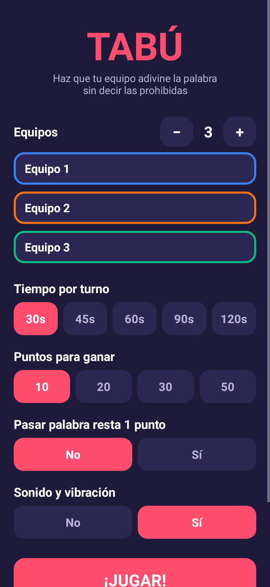
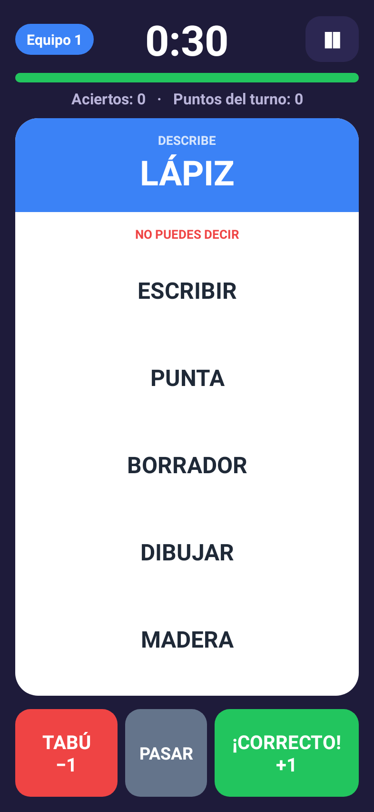
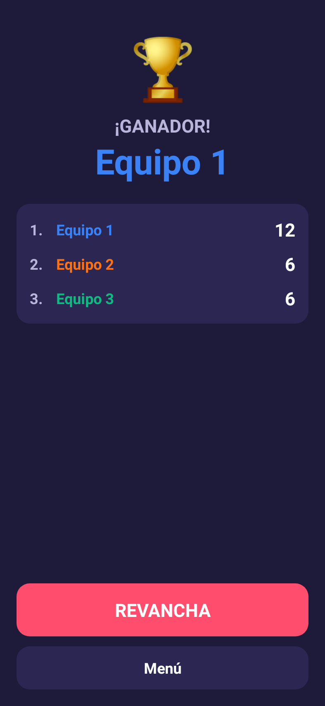

# Tabú

Juego de fiesta para Android: una persona hace que su equipo adivine una palabra **sin decir las 5 palabras prohibidas** que aparecen en la tarjeta. Se pasan el celular por turnos y cada turno tiene tiempo límite.

**Descargar APK:** [`dist/tabu.apk`](dist/tabu.apk) (48 KB, Android 5.0 o superior)

| Menú | Jugando | Ganador |
|---|---|---|
|  |  |  |

## Cómo se juega

1. Configura de 2 a 4 equipos (con sus nombres), el tiempo por turno (30–120 s) y los puntos para ganar (10–50).
2. En cada turno, una persona describe la palabra grande; su equipo intenta adivinarla.
3. Alguien de otro equipo vigila la pantalla:
   - **¡CORRECTO!** → +1
   - **TABÚ** (dijo una palabra prohibida) → −1
   - **PASAR** → 0 (o −1 si activas la penalización)
4. Al acabar el tiempo se muestra el resumen del turno; toca una palabra para corregir su resultado.
5. Gana el primer equipo que alcance la meta al cerrar una ronda completa. Si hay empate, se juega otra ronda.

Incluye 443 tarjetas en español (con palabras de Colombia como *tinto*, *arepa* o *Transmilenio*), cuenta regresiva con sonido, vibración, pausa (oculta la tarjeta) y la pantalla se mantiene encendida durante el turno. Las tarjetas no se repiten hasta haber usado todo el mazo, aunque cierres la app.

## Instalar

1. Descarga `dist/tabu.apk` en el celular.
2. Ábrelo y permite "instalar apps de origen desconocido" cuando Android lo pida.

## Compilar

```bash
./build.sh   # genera dist/tabu.apk
```

No necesita Android Studio, el Android SDK ni Gradle; solo JDK 17+, `curl`, `unzip` y `zip`. La primera vez descarga sus herramientas en `.build-tools/`: `aapt2` y los recursos del framework (incluidos en Apktool), `dx`, los stubs de `android.jar` y uber-apk-signer (firma v1/v2/v3 + zipalign).

El APK se firma con `keystore/tabu.p12` (contraseña `tabu-android`). Es una llave de desarrollo incluida en el repo para que las versiones nuevas se instalen como actualización encima de la anterior. No es una llave secreta.

## Código

- `app/src/main/java/com/juanddiazm/tabu/MainActivity.java`: toda la app (pantallas creadas por código, temporizador y puntajes).
- `app/src/main/java/com/juanddiazm/tabu/Words.java`: las tarjetas, en formato `PALABRA|prohibida1|…|prohibida5`.
- `app/src/main/res/`: tema e ícono.
